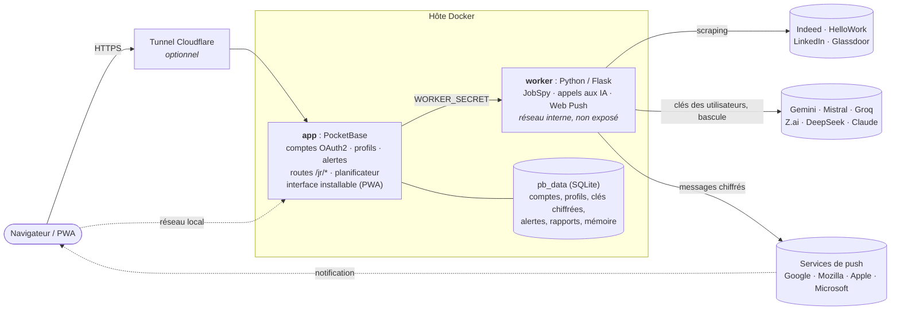
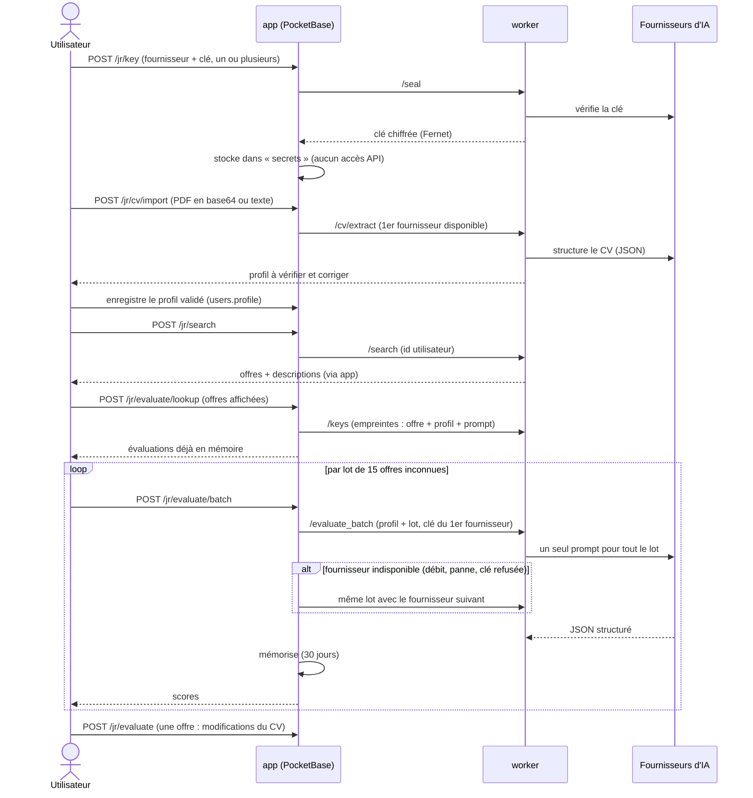
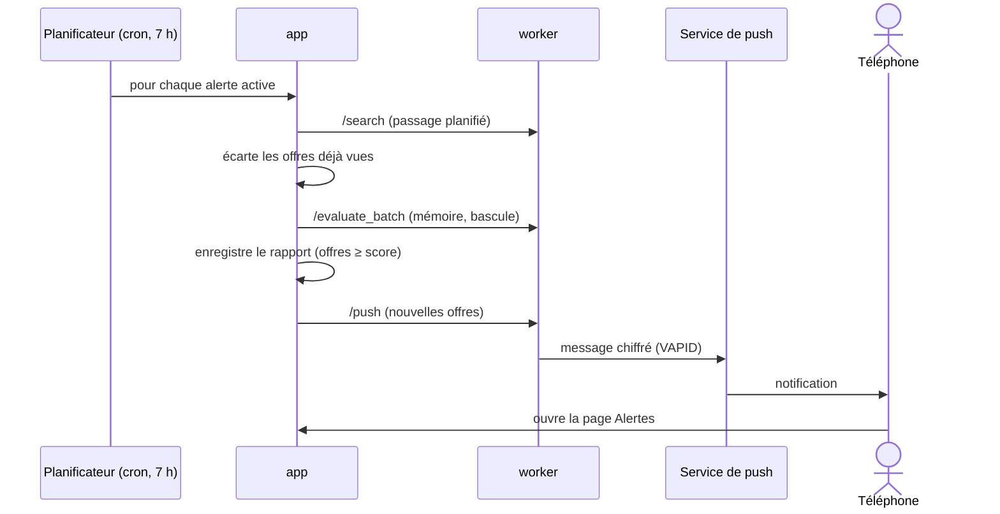
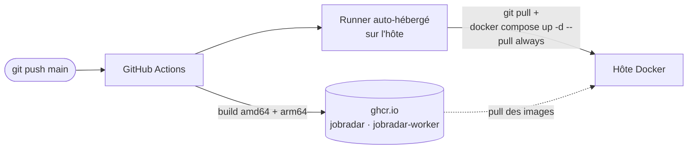

# JobRadar

Cherchez des offres d'emploi sur Indeed, HelloWork, LinkedIn et Glassdoor, puis laissez une IA comparer **votre CV** à chaque offre : score de match, score du CV pour cette offre, forces, manques et **modifications concrètes à apporter au CV**.

Application web multi-utilisateurs : connexion Google / GitHub, et **chaque utilisateur choisit son fournisseur d'IA et fournit sa propre clé API** (Gemini, Mistral, Groq, Z.ai, DeepSeek ou Claude : plusieurs ont une offre gratuite). L'opérateur n'avance aucun frais d'IA.

> L'application aide à postuler, elle ne postule jamais à votre place.

## Sommaire
- [Fonctionnement](#fonctionnement) · [Architecture](#architecture) · [Fournisseurs d'IA](#fournisseurs-dia)
- [Démarrage rapide](#démarrage-rapide) · [Configuration](#configuration) · [Mise en service](#mise-en-service)
- [Déploiement continu](#déploiement-continu) · [Développement local](#développement-local)
- [Sécurité et données](#sécurité-et-données) · [Limites](#limites) · [Structure du dépôt](#structure-du-dépôt)

## Fonctionnement

**Application installable (PWA)** : JobRadar propose lui-même de s'installer (bandeau « Installer » sur Chrome, Edge et Android, mode d'emploi sur iPhone ; « Plus tard » repousse de 14 jours, et deux refus arrêtent les propositions ; une entrée « Installer l'application » reste dans le menu du compte). Une fois installée, elle se comporte comme une application sur téléphone, avec des notifications push chiffrées (clés VAPID générées automatiquement au premier usage). Sur iPhone, les notifications ne fonctionnent que dans l'application installée (iOS 16.4 minimum).

L'interface a quatre pages : **Recherche**, **Alertes**, **Mon profil** et **Paramètres** (accessible, comme le compte, depuis le menu de l'avatar). Une pastille « Terminer la configuration » reste dans la barre tant que l'IA ou le CV manque.

1. **Connexion** avec GitHub ou Google (la photo du compte est reprise et affichée dans la barre, le menu et le profil, avec les initiales en repli).
2. **Paramètres** : l'utilisateur ajoute **un ou plusieurs fournisseurs d'IA** avec leur clé API (vérifiée, puis stockée chiffrée) et les classe par priorité. Le premier est utilisé ; s'il est indisponible (limite de débit, panne, crédit épuisé, clé refusée), JobRadar bascule automatiquement sur le suivant et met le fautif en pause quelques minutes (24 h si la clé est refusée).
3. **Mon profil** : il importe son CV en **PDF** (ou colle son texte, ou remplit à la main). Le texte est extrait puis structuré par son IA. Il **vérifie et corrige** ensuite chaque information : identité, expériences (avec leur *catégorie* : emploi, stage, alternance, freelance, projet, bénévolat), formations, compétences classées par catégorie, langues et critères de recherche (postes visés, contrats, lieux, télétravail, niveau). Le PDF n'est pas conservé ; l'utilisateur n'écrit jamais de fichier markdown.
4. **Recherche** : poste, lieu, sites, ancienneté (préremplis depuis le profil). Les offres arrivent, puis les évaluations se remplissent au fil de l'eau, triées par score de match. Les scores sont calculés **par lot de 15 offres en une seule requête d'IA** (le profil n'est envoyé qu'une fois ; taille unique pour tous les fournisseurs, réglable avec `EVAL_BATCH`, pour que la bascule marche avec n'importe lequel). Une offre déjà évaluée pour le même profil n'est **pas réévaluée** (mémoire par empreinte), et si l'IA saute une offre d'un lot, elle est redemandée une fois. Les modifications de CV, plus coûteuses, se demandent offre par offre.
5. **Sur téléphone**, le formulaire se replie en résumé une fois les résultats là, et une offre ouverte prend tout l'écran (barre « Résultats » / « Voir l'offre » collée en haut, le bouton retour du navigateur la referme).
6. Pour chaque offre, la **description complète** s'affiche directement (rendue en mise en forme, pas en markdown brut), avec : scores (match profil/offre et qualité du CV pour cette offre), forces, points à renforcer, et modifications proposées en « avant / après » avec la raison. L'utilisateur reste libre de les appliquer ou non.

**Pré-traitement sans IA** : le worker repère dans chaque offre le salaire (champs du site, sinon formules courantes : « 45-55k€ », « 2 800 à 3 200 € par mois », « TJM 450 € »…), le contrat, le télétravail, et calcule une pertinence estimée (mots de la recherche dans le titre, compétences du profil dans le texte). Le salaire est aussi un **critère de recherche** (minimum annuel brut, option « salaire indiqué uniquement »), appliqué côté serveur, donc aussi par les alertes. La case « Évaluer avec l'IA » de la recherche est cochée par défaut ; décochée, aucune requête n'est faite au fournisseur. Les **lieux** sont multiples (3 au maximum, une recherche par lieu, résultats fusionnés et dédoublonnés) avec un **rayon** en km (10, 25, 50, 100) transmis aux sites qui le gèrent (Indeed, HelloWork, LinkedIn, Glassdoor), pour la recherche comme pour les alertes. L'IA n'est qu'un plus : sans clé, ou si le fournisseur est en panne, la recherche et les alertes continuent de fonctionner.

**Alertes quotidiennes** : depuis une recherche (« Créer une alerte ») ou la page Alertes, l'utilisateur enregistre jusqu'à 3 recherches (poste, lieu, sites, ancienneté, score minimum). Chaque matin, JobRadar les relance avec **le profil et la clé de cet utilisateur**, écarte les offres déjà vues, évalue les nouvelles si l'IA est disponible (par lot, avec la mémoire) et publie un **rapport** : avec l'IA, seules les nouvelles offres au-dessus du score apparaissent ; sans IA (pas de clé, quota épuisé, panne), toutes les nouvelles offres sont transmises, classées par pertinence estimée, avec une pastille de rapports non lus dans la navigation. La page est pensée pour le téléphone. « Lancer maintenant » déclenche un passage à la demande (un par 10 minutes et par alerte). Dès qu'une alerte existe, l'application **propose d'activer les notifications** (bandeau sous la barre, juste après la création d'une alerte et à chaque ouverture tant que l'appareil n'est pas abonné ; « Plus tard » repousse de 7 jours, deux refus arrêtent, une désactivation volontaire ou un blocage du navigateur sont respectés). Quand un passage trouve du nouveau, une **notification push** est envoyée aux appareils abonnés (l'e-mail viendra ensuite, par le même point d'envoi).

**Sans configuration, la recherche fonctionne quand même** : si l'IA ou le profil manque, une fenêtre propose de configurer (ou de chercher sans scores). Les offres s'affichent alors sans évaluation, et chacune peut être évaluée plus tard.

## Design

Direction « signalisation routière » : le match d'une offre se lit comme une distance sur un panneau de direction (plein = proche, contour = moyen, pointillé = loin), la source est une pastille ronde, le jaune est réservé à la sélection et au focus. Lettrage Barlow (hébergé avec l'application, licence SIL OFL), clair et sombre selon le système, accessibilité AA. Le système est décrit dans [DESIGN.md](DESIGN.md) ; le contexte produit dans [PRODUCT.md](PRODUCT.md).

## Architecture



| Composant | Rôle |
|---|---|
| **app** (`server/`) | PocketBase : connexion OAuth2, stockage (profil, clés chiffrées, alertes, rapports, mémoire des évaluations), limitation de débit, en-têtes de sécurité, interface web statique (modules JS sans build, installable en PWA) et routes `/jr/*` (hooks JS). Il orchestre : bascule entre fournisseurs d'IA, mémoire, passages d'alertes planifiés (cron), envoi des notifications. C'est la seule porte d'entrée. |
| **worker** (`worker/`) | Service Python interne et sans état : recherche d'offres (JobSpy), vérification et chiffrement des clés, extraction du texte des PDF (pypdf) et structuration du CV, évaluation par le fournisseur d'IA demandé, empreintes de cache, envoi Web Push (VAPID). N'accepte que les appels de l'app (secret partagé). |
| **cloudflared** | Optionnel : expose l'app sur Internet sans ouvrir de port. |

### Le parcours d'une évaluation



### Le parcours d'une alerte



## Fournisseurs d'IA

Un utilisateur peut en configurer plusieurs et les classer par priorité (bascule automatique). Définis dans [`worker/providers.json`](worker/providers.json) (identifiant, libellé, URL, modèle, mention de confidentialité). Pour en ajouter un : toute API compatible OpenAI (`"kind": "openai"`) s'ajoute avec une entrée, sans toucher au code.

| Fournisseur | Gratuit | Remarque |
|---|---|---|
| Google Gemini | oui (limité) | En gratuit, Google peut réutiliser les données. |
| Mistral | oui (limité) | Entreprise française ; le palier gratuit demande d'accepter l'entraînement sur les données. |
| Groq (Llama) | oui (limité) | Serveurs aux États-Unis. |
| Z.ai (GLM) | oui (limité) | Fournisseur chinois. |
| DeepSeek | non, très bon marché | Fournisseur chinois. |
| Claude (Anthropic) | non | Meilleure qualité ; clé API à l'usage, **distincte d'un abonnement Claude Pro**. |

Les noms de modèles et les offres gratuites évoluent vite : vérifiez-les dans `providers.json`. Le CV de l'utilisateur est envoyé au fournisseur qu'il choisit ; l'interface affiche la mention de confidentialité correspondante.

## Démarrage rapide

Prérequis : Docker avec Compose.

```bash
git clone https://github.com/LilyanLefevre/JobRadar.git && cd JobRadar
cp .env.example .env
# renseigner WORKER_SECRET et SECRETS_KEY (openssl rand -hex 32 pour chacun)
docker compose up -d --build
```

Interface : <http://localhost:8090> · Dashboard PocketBase : <http://localhost:8090/_/>

Créez ensuite le compte administrateur (voir [Mise en service](#mise-en-service)) et configurez la connexion OAuth.

## Configuration

Tout se règle dans `.env` (modèle : [`.env.example`](.env.example)). Jamais commité.

| Variable | Défaut | Rôle |
|---|---|---|
| `WORKER_SECRET` | *(obligatoire)* | Secret partagé entre l'app et le worker. |
| `SECRETS_KEY` | *(obligatoire)* | Chiffre les clés API en base. **Ne plus la changer** une fois en service (les clés enregistrées deviendraient illisibles). |
| `SEARCHES_PER_DAY` | `10` | Recherches par utilisateur et par jour. |
| `TZ` | `Europe/Paris` | Fuseau horaire du serveur, donc des alertes. |
| `ALERTS_CRON` | `0 7 * * *` | Heure du passage quotidien des alertes (format cron). |
| `ALERTS_PER_USER` | `3` | Alertes maximum par utilisateur. |
| `EVAL_BATCH` | `15` | Offres évaluées par requête d'IA, pour tous les fournisseurs (1 à 40). À baisser si un fournisseur gratuit refuse des lots trop gros. |
| `VAPID_SUBJECT` | `mailto:noreply@example.com` | Adresse de contact transmise aux services de notification push. Mettez la vôtre. |
| `SIGNUP_ALLOWLIST` | vide | E-mails autorisés à s'inscrire, séparés par des virgules. Vide = inscription ouverte. |
| `JOBRADAR_MODEL` | vide | Remplace le modèle Claude de `providers.json`. |
| `JOBRADAR_BIND` | `127.0.0.1` | Adresse d'écoute (`0.0.0.0` pour le réseau local). |
| `JOBRADAR_PORT` | `8090` | Port exposé sur l'hôte. |
| `JOBRADAR_IMAGE` / `JOBRADAR_WORKER_IMAGE` | images de ce dépôt | Images à utiliser. |
| `COMPOSE_PROFILES` | vide | `tunnel` pour démarrer `cloudflared`. |
| `CLOUDFLARED_TOKEN` | vide | Jeton du tunnel Cloudflare (profil `tunnel`). |
| `ADMIN_PUBLIC` | vide | `1` pour autoriser le dashboard via le tunnel public (déconseillé). |
| `PROVIDERS_FILE` | `worker/providers.json` | Fichier de fournisseurs alternatif (variable du worker). |

## Mise en service

### 1. Compte administrateur
Au premier démarrage, PocketBase affiche dans les logs un lien d'installation, valable environ une heure :
```bash
docker compose logs app | grep pbinstall
```
Ouvrez-le (en remplaçant l'hôte par le vôtre), ou créez le compte en ligne de commande :
```bash
docker compose exec app /pb/pocketbase superuser upsert vous@exemple.com 'mot-de-passe-long' --dir /pb/pb_data
```

### 2. Connexion OAuth
Dans le dashboard : *Collections > users > Edit collection > Options > OAuth2*, ajoutez GitHub et/ou Google avec l'identifiant et le secret créés dans leurs consoles développeur. URL de redirection à déclarer chez eux :
```
https://<votre-domaine>/api/oauth2-redirect
```
La connexion par mot de passe est désactivée : les comptes ne se créent que par OAuth.

Google : dans la console Google Cloud, configurez l'écran de consentement (type Externe, **publié**), puis créez un *ID client OAuth* de type *Application Web* avec l'URI de redirection ci-dessus. GitHub : *Settings > Developer settings > OAuth Apps*, avec la même URL de rappel.

### 3. Exposer sur Internet (optionnel)
1. Créez un tunnel dans le tableau de bord Cloudflare (Zero Trust > Networks > Tunnels) et ajoutez un *Public Hostname* vers le service `http://app:8090`.
2. Dans `.env` : `COMPOSE_PROFILES=tunnel` et `CLOUDFLARED_TOKEN=<jeton>`, puis `docker compose up -d`.

Quand la requête arrive par le tunnel, seules les collections de l'utilisateur (compte, alertes, rapports) sont joignables, chacune limitée à ses propres données par ses règles d'accès : les API d'administration (connexion superuser, réglages, sauvegardes, logs…) sont **bloquées**, par nom comme par identifiant. L'interface statique de `/_/` reste servie (PocketBase y affiche la page de succès de la connexion OAuth) mais ne peut pas se connecter. Pour administrer, passez par le port local ou un tunnel SSH :
```bash
ssh -L 8090:127.0.0.1:8090 <hôte>   # puis http://localhost:8090/_/
```

### 4. Notifications et installation
Les notifications push et l'installation en PWA demandent **HTTPS** (le tunnel Cloudflare suffit). Renseignez `VAPID_SUBJECT` (votre adresse, `mailto:vous@exemple.com`) dans `.env` ; les clés VAPID sont générées automatiquement au premier usage et mémorisées en base. Chaque utilisateur active les notifications depuis l'application (bandeau proposé dès qu'il crée une alerte, ou Paramètres).

### 5. Inviter des amis
Mettez leurs e-mails dans `SIGNUP_ALLOWLIST`, puis `docker compose up -d`. Chacun choisit son fournisseur d'IA et ajoute sa clé.

### Sauvegarde et mise à jour
- À sauvegarder : le dossier `pb_data/` (comptes, CV, clés chiffrées) **et** `SECRETS_KEY`.
- Mise à jour manuelle : `git pull && docker compose up -d --pull always`. Avec le déploiement continu, c'est automatique.

## Déploiement continu



Le workflow [`deploy.yml`](.github/workflows/deploy.yml) construit les deux images, les publie, puis un runner GitHub installé sur la machine hôte (connexion sortante uniquement, aucun port à ouvrir) met à jour le déploiement dans `~/JobRadar`. Il n'utilise que `GITHUB_TOKEN` : les secrets (`.env`) ne vivent que sur l'hôte. Dependabot propose des mises à jour hebdomadaires (actions, images Docker, dépendances Python).

## Développement local

Sans Docker (nécessite Python 3.12 et le binaire [PocketBase](https://pocketbase.io/docs/)) :

```bash
# 1. Worker
cd worker && python3 -m venv .venv && .venv/bin/pip install -r requirements.txt
WORKER_SECRET=dev SECRETS_KEY=dev .venv/bin/python -m flask --app app run -p 5055

# 2. PocketBase (autre terminal, depuis server/)
WORKER_URL=http://127.0.0.1:5055 WORKER_SECRET=dev \
  pocketbase serve --http=127.0.0.1:8090 --dir=../pb_data \
  --migrationsDir=pb_migrations --hooksDir=pb_hooks --publicDir=pb_public
```

Tests : `node --test tests/md.test.mjs` vérifie le rendu des descriptions. La suite de bout en bout est dans `tests/e2e/` : `tests/e2e/run.sh` démarre un faux fournisseur d'IA, un faux service de push, un faux OIDC, le worker (offres fixes via `JOBS_FIXTURE`) et un PocketBase vierge, puis enchaîne les parcours (fournisseurs, mémoire, alertes, notifications, PWA, mobile, cibles tactiles). Prérequis : binaire `pocketbase`, Python (dépendances du worker), Node 20+, Chrome (`PW_CHANNEL=chromium` sinon). Variables : `PY`, `PB_BIN`.

Pour tester sans clé réelle, `PROVIDERS_FILE` permet de pointer le worker vers un faux fournisseur local compatible OpenAI. Pour tester la connexion sans GitHub ni Google, PocketBase accepte un fournisseur OIDC générique (*users > Options > OAuth2 > oidc*) que l'on peut pointer vers un petit faux serveur local. Pour tester les notifications, `PUSH_ALLOWED_HOSTS=127.0.0.1` (variable du worker, **jamais en production**) autorise un faux service de push local, et `JOBS_FIXTURE` (idem, tests uniquement) sert des offres fixes au lieu du scraping.

## Sécurité et données

Résumé ci-dessous ; détails et risques résiduels dans [SECURITY.md](SECURITY.md).

- Connexion OAuth2 uniquement ; création de compte directe par l'API refusée (règle `@request.context = 'oauth2'`) ; inscription limitable par liste d'invités.
- Les clés API sont vérifiées puis **chiffrées** (Fernet) dans une collection sans aucune règle d'API : elles ne sont jamais renvoyées au navigateur.
- Le worker n'est pas exposé ; il vérifie un secret partagé à chaque appel.
- Limitation de débit, en-têtes de sécurité (CSP stricte, HSTS), API d'administration inaccessibles par le tunnel public (liste blanche de collections : compte, alertes, rapports).
- Notifications push chiffrées de bout en bout, envoyées uniquement aux vrais services de push (pas d'appel vers le réseau interne) ; la mémoire des évaluations, les alertes et leurs rapports sont propres à chaque utilisateur et supprimés avec le compte.
- Conteneurs durcis : worker non-root, système de fichiers en lecture seule, sans capacités.
- Chaque utilisateur peut **supprimer son compte** depuis l'interface (CV et clé API supprimés en cascade).

## Limites

- JobSpy ne couvre ni l'APEC, ni Welcome to the Jungle, ni France Travail : ces offres n'apparaissent pas.
- Le scraping des job boards peut enfreindre leurs conditions d'utilisation et provoquer des blocages d'IP : volumes modestes, quota par utilisateur, inscription sur invitation recommandée.
- Les résultats d'une recherche manuelle ne sont pas conservés ; sont conservés le profil, la clé API, une **mémoire des évaluations** (30 jours), les alertes, leurs rapports (60 jours) et la liste des offres déjà vues (90 jours), le tout supprimé avec le compte.
- Les notifications push dépendent des services de Google, Mozilla, Apple ou Microsoft selon le navigateur ; le contenu est chiffré de bout en bout.
- Les alertes consomment l'IA de l'utilisateur (au plus 60 nouvelles offres évaluées par passage). Les passages sont séquentiels : avec beaucoup d'utilisateurs, ils s'étalent sur la matinée.
- L'import fonctionne sur les PDF contenant du texte (5 Mo et 15 pages maximum) ; un PDF scanné (image) n'est pas lu : collez le texte ou remplissez le profil. L'extraction par IA peut se tromper, d'où l'étape de vérification.
- Les évaluations sont des suggestions d'une IA : relisez-les, elles peuvent se tromper. N'y laissez jamais inventer d'expérience.
- Le profil et la mémoire des évaluations (texte généré à partir du CV) sont stockés en clair dans SQLite, sans chiffrement au repos, contrairement aux clés API. L'extraction demande à l'IA d'omettre e-mail, téléphone et adresse.

## Structure du dépôt

```
.
├── docker-compose.yml        # app + worker (+ cloudflared en option)
├── .env.example              # modèle de configuration
├── server/                   # PocketBase
│   ├── Dockerfile            # binaire vérifié par SHA-256, amd64 + arm64
│   ├── pb_migrations/        # schéma, dans l'ordre : 1 utilisateurs/secrets · 2 fournisseur · 3 limites de débit · 4 règle d'inscription
│   │                         #   5 profil · 6 mémoire des évaluations · 7 alertes · 8 multi-fournisseurs + push · 9 limite des tests push · 10 miniatures de photo
│   ├── pb_hooks/
│   │   ├── jobradar.pb.js    # routes /jr/*, en-têtes de sécurité, filtre du tunnel, inscriptions, planification (cron)
│   │   └── lib.js            # bascule entre fournisseurs, mémoire, passages d'alertes, notifications
│   └── pb_public/            # interface (modules JS sans build, versionnés par URL)
│       ├── index.html · style.css · app.js          # coque, thème, routeur, menu de compte, bandeaux d'invitation
│       ├── search.js · alerts.js · profile.js · settings.js   # les quatre pages
│       ├── lib.js · icons.js · md.js                # utilitaires, icônes dessinées, rendu markdown sûr
│       ├── push.js · install.js · sw.js · manifest.webmanifest   # PWA : notifications, installation, service worker
│       └── fonts/ · icons/ · pocketbase.umd.js      # Barlow hébergé, icônes de l'app, SDK PocketBase
├── worker/                   # service Python interne
│   ├── app.py                # recherche, chiffrement des clés, import du CV, évaluation, empreintes, Web Push
│   └── providers.json        # fournisseurs d'IA et modèles
├── tests/                    # rendu markdown (md.test.mjs) et suite de bout en bout (e2e/)
├── PRODUCT.md · DESIGN.md    # contexte produit et système de design
└── .github/                  # déploiement continu, Dependabot
```
