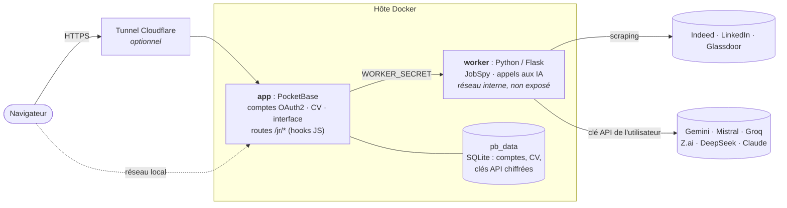
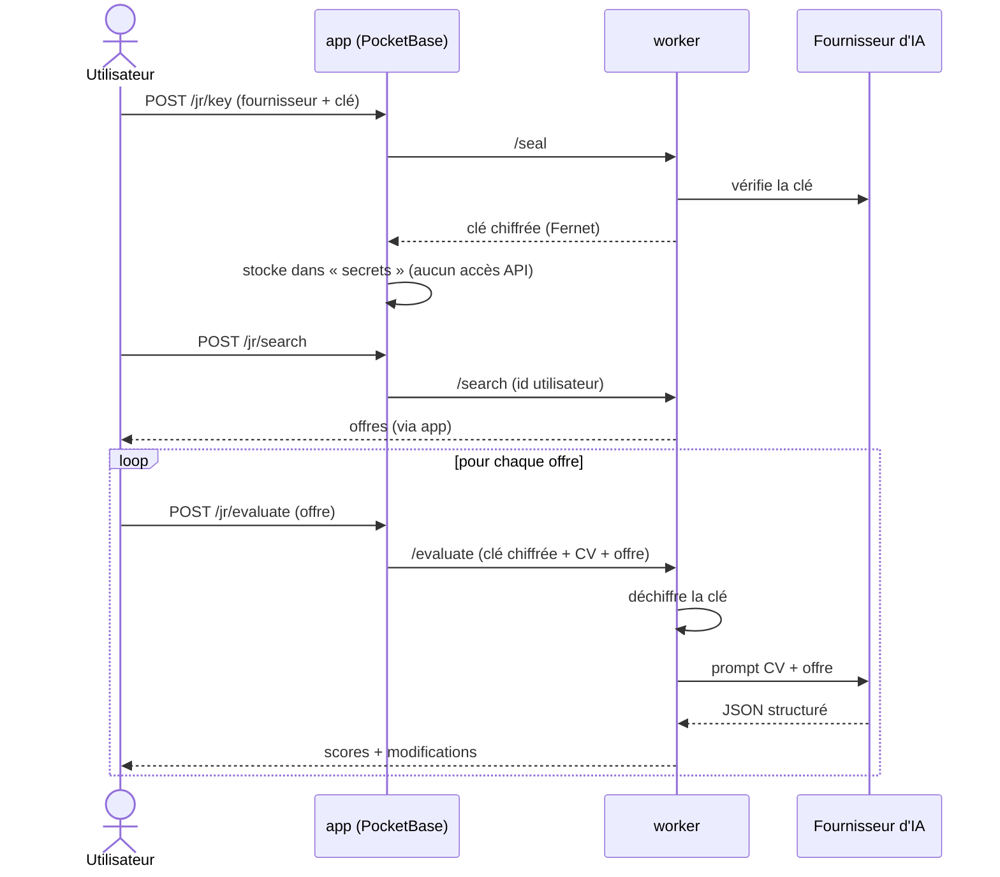

# JobRadar

Cherchez des offres d'emploi sur Indeed, LinkedIn et Glassdoor, puis laissez une IA comparer **votre CV** à chaque offre : score de match, score du CV pour cette offre, forces, manques et **modifications concrètes à apporter au CV**.

Application web multi-utilisateurs : connexion Google / GitHub, et **chaque utilisateur choisit son fournisseur d'IA et fournit sa propre clé API** (Gemini, Mistral, Groq, Z.ai, DeepSeek ou Claude : plusieurs ont une offre gratuite). L'opérateur n'avance aucun frais d'IA.

> L'application aide à postuler, elle ne postule jamais à votre place.

## Sommaire
- [Fonctionnement](#fonctionnement) · [Architecture](#architecture) · [Fournisseurs d'IA](#fournisseurs-dia)
- [Démarrage rapide](#démarrage-rapide) · [Configuration](#configuration) · [Mise en service](#mise-en-service)
- [Déploiement continu](#déploiement-continu) · [Développement local](#développement-local)
- [Sécurité et données](#sécurité-et-données) · [Limites](#limites) · [Structure du dépôt](#structure-du-dépôt)

## Fonctionnement

1. L'utilisateur se connecte avec GitHub ou Google.
2. Il choisit un fournisseur d'IA et colle sa clé API : elle est vérifiée, puis stockée chiffrée.
3. Il colle son CV (texte ou markdown) et lance une recherche (poste, lieu, sites, ancienneté).
4. Les offres arrivent, puis les évaluations se remplissent au fil de l'eau (3 en parallèle). La liste est triée par score de match.
5. Pour chaque offre : scores, forces, manques et modifications proposées en « avant / après » avec la raison. L'utilisateur reste libre de les appliquer ou non.

## Architecture



| Composant | Rôle |
|---|---|
| **app** (`server/`) | PocketBase : connexion OAuth2, stockage du CV, limitation de débit, en-têtes de sécurité, interface web statique et routes `/jr/*`. C'est la seule porte d'entrée. |
| **worker** (`worker/`) | Service Python interne : recherche d'offres (JobSpy), vérification et chiffrement des clés, évaluation par le fournisseur d'IA choisi. N'accepte que les appels de l'app (secret partagé). |
| **cloudflared** | Optionnel : expose l'app sur Internet sans ouvrir de port. |

### Le parcours d'une évaluation



## Fournisseurs d'IA

Définis dans [`worker/providers.json`](worker/providers.json) (identifiant, libellé, URL, modèle, mention de confidentialité). Pour en ajouter un : toute API compatible OpenAI (`"kind": "openai"`) s'ajoute avec une entrée, sans toucher au code.

| Fournisseur | Gratuit | Remarque |
|---|---|---|
| Google Gemini | oui (limité) | En gratuit, Google peut réutiliser les données. |
| Mistral | oui (limité) | Entreprise française ; le palier gratuit demande d'accepter l'entraînement sur les données. |
| Groq (Llama) | oui (limité) | Serveurs aux États-Unis. |
| Z.ai (GLM) | oui (limité) | Fournisseur chinois. |
| DeepSeek | non, très bon marché | Fournisseur chinois. |
| Claude (Anthropic) | non | Meilleure qualité ; clé API à l'usage, **distincte d'un abonnement Claude Pro**. |

Les noms de modèles et les offres gratuites évoluent vite : vérifiez-les dans `providers.json`. Le CV de l'utilisateur est envoyé au fournisseur qu'il choisit ; l'interface affiche la mention de confidentialité correspondante.

## Démarrage rapide

Prérequis : Docker avec Compose.

```bash
git clone https://github.com/LilyanLefevre/JobRadar.git && cd JobRadar
cp .env.example .env
# renseigner WORKER_SECRET et SECRETS_KEY (openssl rand -hex 32 pour chacun)
docker compose up -d --build
```

Interface : <http://localhost:8090> · Dashboard PocketBase : <http://localhost:8090/_/>

Créez ensuite le compte administrateur (voir [Mise en service](#mise-en-service)) et configurez la connexion OAuth.

## Configuration

Tout se règle dans `.env` (modèle : [`.env.example`](.env.example)). Jamais commité.

| Variable | Défaut | Rôle |
|---|---|---|
| `WORKER_SECRET` | *(obligatoire)* | Secret partagé entre l'app et le worker. |
| `SECRETS_KEY` | *(obligatoire)* | Chiffre les clés API en base. **Ne plus la changer** une fois en service (les clés enregistrées deviendraient illisibles). |
| `SEARCHES_PER_DAY` | `10` | Recherches par utilisateur et par jour. |
| `SIGNUP_ALLOWLIST` | vide | E-mails autorisés à s'inscrire, séparés par des virgules. Vide = inscription ouverte. |
| `JOBRADAR_MODEL` | vide | Remplace le modèle Claude de `providers.json`. |
| `JOBRADAR_BIND` | `127.0.0.1` | Adresse d'écoute (`0.0.0.0` pour le réseau local). |
| `JOBRADAR_PORT` | `8090` | Port exposé sur l'hôte. |
| `JOBRADAR_IMAGE` / `JOBRADAR_WORKER_IMAGE` | images de ce dépôt | Images à utiliser. |
| `COMPOSE_PROFILES` | vide | `tunnel` pour démarrer `cloudflared`. |
| `CLOUDFLARED_TOKEN` | vide | Jeton du tunnel Cloudflare (profil `tunnel`). |
| `ADMIN_PUBLIC` | vide | `1` pour autoriser le dashboard via le tunnel public (déconseillé). |
| `PROVIDERS_FILE` | `worker/providers.json` | Fichier de fournisseurs alternatif (variable du worker). |

## Mise en service

### 1. Compte administrateur
Au premier démarrage, PocketBase affiche dans les logs un lien d'installation, valable environ une heure :
```bash
docker compose logs app | grep pbinstall
```
Ouvrez-le (en remplaçant l'hôte par le vôtre), ou créez le compte en ligne de commande :
```bash
docker compose exec app /pb/pocketbase superuser upsert vous@exemple.com 'mot-de-passe-long' --dir /pb/pb_data
```

### 2. Connexion OAuth
Dans le dashboard : *Collections > users > Edit collection > Options > OAuth2*, ajoutez GitHub et/ou Google avec l'identifiant et le secret créés dans leurs consoles développeur. URL de redirection à déclarer chez eux :
```
https://<votre-domaine>/api/oauth2-redirect
```
La connexion par mot de passe est désactivée : les comptes ne se créent que par OAuth.

### 3. Exposer sur Internet (optionnel)
1. Créez un tunnel dans le tableau de bord Cloudflare (Zero Trust > Networks > Tunnels) et ajoutez un *Public Hostname* vers le service `http://app:8090`.
2. Dans `.env` : `COMPOSE_PROFILES=tunnel` et `CLOUDFLARED_TOKEN=<jeton>`, puis `docker compose up -d`.

Le dashboard (`/_/`) et les API d'administration sont **bloqués** quand la requête arrive par le tunnel. Pour administrer, passez par le port local ou un tunnel SSH :
```bash
ssh -L 8090:127.0.0.1:8090 <hôte>   # puis http://localhost:8090/_/
```

### 4. Inviter des amis
Mettez leurs e-mails dans `SIGNUP_ALLOWLIST`, puis `docker compose up -d`. Chacun choisit son fournisseur d'IA et ajoute sa clé.

### Sauvegarde et mise à jour
- À sauvegarder : le dossier `pb_data/` (comptes, CV, clés chiffrées) **et** `SECRETS_KEY`.
- Mise à jour manuelle : `git pull && docker compose up -d --pull always`. Avec le déploiement continu, c'est automatique.

## Déploiement continu


Le workflow [`deploy.yml`](.github/workflows/deploy.yml) construit les deux images, les publie, puis un runner GitHub installé sur la machine hôte (connexion sortante uniquement, aucun port à ouvrir) met à jour le déploiement dans `~/JobRadar`. Il n'utilise que `GITHUB_TOKEN` : les secrets (`.env`) ne vivent que sur l'hôte. Dependabot propose des mises à jour hebdomadaires (actions, images Docker, dépendances Python).

## Développement local

Sans Docker (nécessite Python 3.12 et le binaire [PocketBase](https://pocketbase.io/docs/)) :

```bash
# 1. Worker
cd worker && python3 -m venv .venv && .venv/bin/pip install -r requirements.txt
WORKER_SECRET=dev SECRETS_KEY=dev .venv/bin/python -m flask --app app run -p 5055

# 2. PocketBase (autre terminal, depuis server/)
WORKER_URL=http://127.0.0.1:5055 WORKER_SECRET=dev \
  pocketbase serve --http=127.0.0.1:8090 --dir=../pb_data \
  --migrationsDir=pb_migrations --hooksDir=pb_hooks --publicDir=pb_public
```

Pour tester sans clé réelle, `PROVIDERS_FILE` permet de pointer le worker vers un faux fournisseur local compatible OpenAI.

## Sécurité et données

Résumé ci-dessous ; détails et risques résiduels dans [SECURITY.md](SECURITY.md).

- Connexion OAuth2 uniquement ; création de compte directe par l'API refusée ; inscription limitable par liste d'invités.
- Les clés API sont vérifiées puis **chiffrées** (Fernet) dans une collection sans aucune règle d'API : elles ne sont jamais renvoyées au navigateur.
- Le worker n'est pas exposé ; il vérifie un secret partagé à chaque appel.
- Limitation de débit, en-têtes de sécurité (CSP stricte, HSTS), dashboard d'administration inaccessible par le tunnel public.
- Conteneurs durcis : worker non-root, système de fichiers en lecture seule, sans capacités.
- Chaque utilisateur peut **supprimer son compte** depuis l'interface (CV et clé API supprimés en cascade).

## Limites

- Le scraping des job boards peut enfreindre leurs conditions d'utilisation et provoquer des blocages d'IP : volumes modestes, quota par utilisateur, inscription sur invitation recommandée.
- Les résultats de recherche ne sont pas conservés (seuls le CV et la clé API le sont).
- Les évaluations sont des suggestions d'une IA : relisez-les, elles peuvent se tromper. N'y laissez jamais inventer d'expérience.
- Le CV est stocké en clair dans SQLite (pas de chiffrement au repos), contrairement aux clés API.

## Structure du dépôt

```
.
├── docker-compose.yml        # app + worker (+ cloudflared en option)
├── .env.example              # modèle de configuration
├── server/                   # PocketBase
│   ├── Dockerfile            # binaire vérifié par SHA-256, amd64 + arm64
│   ├── pb_migrations/        # schéma : CV, secrets, fournisseur, limites de débit
│   ├── pb_hooks/             # routes /jr/*, sécurité (en-têtes, admin, inscriptions)
│   └── pb_public/            # interface (index.html, app.js, SDK PocketBase)
├── worker/                   # service Python interne
│   ├── app.py                # recherche, chiffrement des clés, évaluation
│   └── providers.json        # fournisseurs d'IA et modèles
└── .github/                  # déploiement continu, Dependabot
```
